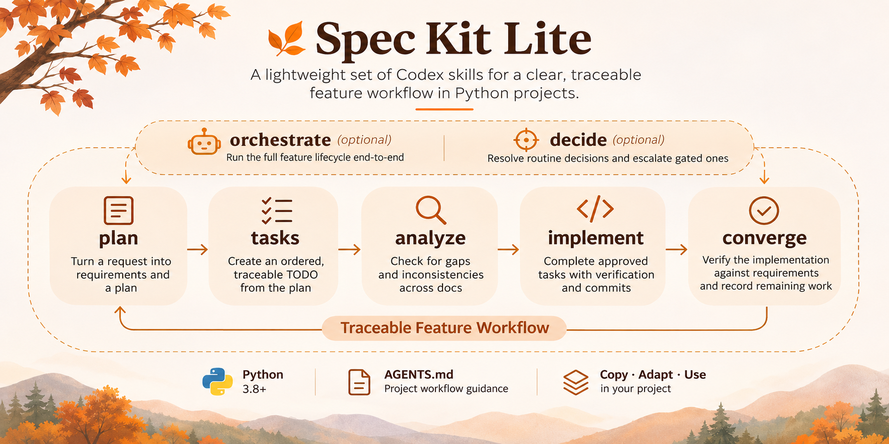

I built these lightweight Codex skills to bring a clear, traceable feature workflow to projects that are largely Python-based. They guide planning, implementation, analysis, and verification through requirements, plans, and task documents.

## Included skills

- **analyze** — Find material gaps and inconsistencies in requirements, architecture, plans, and TODOs.
- **converge** — Verify an implementation against its requirements and record remaining work.
- **decide** — Resolve routine project decisions from available evidence and escalate gated decisions.
- **implement** — Implement approved TODO tasks with lineage, verification, and commit guidance.
- **orchestrate** — Run the feature lifecycle from planning through convergence, continuing after plan approval.
- **plan** — Turn requirements into an approved plan and ordered TODO.
- **tasks** — Generate a dependency-ordered, traceable TODO from an approved plan.

`AGENTS.md` contains the repository workflow guidance these skills refer to. It covers Git status, staging, commit and push rules, and workflow through `$orchestrate` and `$decide`, alongside testing, debugging, and infrastructure/security safeguards. It is intended to be copied into a project where you want these conventions applied; review and adapt it to that project's workflow first.

## Install

Requirements: Python 3.8 or newer. Clone the repository once, then run the installer. It installs the skills into `~/.agents/skills/` and can copy `AGENTS.md` into a project folder.

macOS or Linux:

```sh
git clone https://github.com/suriyadeepan/speckit-lite.git
python speckit-lite/setup.py --project /path/to/your/project
```

On systems where the command is `python3`:

```sh
python3 speckit-lite/setup.py --project /path/to/your/project
```

Windows PowerShell:

```powershell
git clone https://github.com/suriyadeepan/speckit-lite.git
py .\speckit-lite\setup.py --project "C:\path\to\your\project"
```

Review the copied `AGENTS.md` and adapt it to the project as needed. On Windows, skills are installed under the current user's home directory.

To update or replace already installed skills, run:

```sh
python speckit-lite/setup.py --update --project /path/to/your/project
```

Restart Codex or start a new session after installing so it discovers the skills.

## Use in Codex

Start Codex in your project, then walk a small feature through the skills. For example, to add a `/health` endpoint that returns `{"status":"ok"}`:

1. **Requirement:** Ask Codex, “Add a `/health` endpoint that returns `{"status":"ok"}`.” This is the feature request to refine.
2. `$plan {req}` : “Use the plan skill to turn this request into requirements and an implementation plan.” Review and approve the plan before proceeding.
3. `$tasks` :  “Use the tasks skill to create an ordered TODO from the approved plan.” This breaks the plan into traceable implementation tasks.
4. `$analyze` : “Use the analyze skill to check the requirements, plan, and TODO for gaps or inconsistencies.” Fix any issues before coding.
5. `$implement T00x` : “Use the implement skill to complete the TODO.” Codex works through the approved tasks and records verification.
6. `$converge` : “Use the converge skill to verify the implementation against the requirements and record any remaining gaps.”

For the complete lifecycle, use `$orchestrate`: it runs planning, waits for plan approval, then continues through tasks, analysis, implementation, and convergence. Use `$decide` to resolve routine choices from project evidence; it escalates decisions that need approval or user input. Project-specific instructions still apply, so review and adapt the copied `AGENTS.md` before using it.

## Manual install

Copy a skill directory (including its `SKILL.md`), for example `skills/plan` into `~/.agents/skills/`. For a single project, use that project's `.agents/skills/` directory. Copy `AGENTS.md` to the project root only after adapting it to the project.

## Set auto `/compact`

While running `$orchestrate` skill you might overload the context-window and your agent might be working in dumb zone (context rot). You might wanna setup auto-compact.

Set flag in `~/.codex/config.toml`

```toml
model_post_turn_compact_threshold_percent = 40
```
